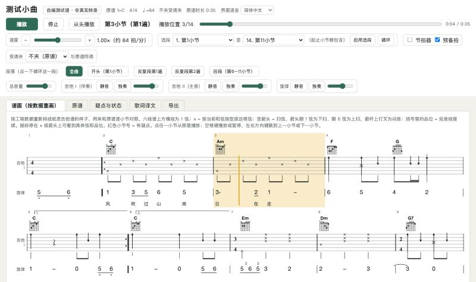

# 吉他跟弹模拟器（Agent Skill）2.0

**把一张吉他谱，变成可以跟着练的网页。**
把“六线谱 + 简谱”的吉他谱图片或 PDF 交给 AI，这个技能包会带着它逐小节转录成工程数据，再用脚本生成一个单文件网页：伴奏和旋律同步发声，谱面上的光标随拍子走。

[English](README.md)



## 2.0 的变化

1.x 直接显示原谱图片，由网页自己识别简谱，快，但识别结果要靠使用者在页面里逐个修改。2.0 改为：

- **先转录成数据，再生成网页。** AI 逐小节看图，把六线谱、和弦指型、简谱、歌词写进 `score.json`；脚本校验后生成播放器。数据是唯一来源，改错只改数据，再重新生成。
- **读不清的地方列为疑点**，不凭猜测补上；页面有“疑点与状态”页，有未解决的关键疑点时顶部标“待校对试听版”。
- **自动自查**：每小节时值、和弦指型、吉他旋律与简谱互校（`pitchcheck`），以及可能读错八度点的“旋律大跳”提醒。
- 去掉了“在网页里直接修改旋律”；保留九种界面语言和歌词译文。

## 生成的页面能做什么

- **重画谱面**：按数据排成纸质吉他谱的样子（六线谱、和弦图、扫弦箭头、简谱、歌词），用来和原谱逐小节对照
- **原谱页**：按小节坐标把原谱逐行切开，宽屏自动分栏、一屏放完；当前小节标黄，竖线随拍子移动
- 伴奏、旋律分声部发声（合成音色，不用采样），各声部可静音、独奏、调音量
- **调速**（0.5～1.5 倍，不变调）、**节拍器**、**预备拍**、**变调夹**（0～7 品，整体移调）
- **选段循环**、**段落按钮**一键循环、点小节跳转、空格播放暂停、左右方向键换小节；反复记号自动展开
- **九种界面语言**：简体中文、繁體中文、English、日本語、한국어、Español、Français、Deutsch、Português
- **歌词译文**：使用者按句输入或整段粘贴译文，显示在谱面歌词下方，播放时顶部显示当前一句；可下载、从文件载入、清除；发布为 Claude Artifact 时还可保存到账号
- 速度、音量、语言等设置记在本机浏览器里；跟随系统深浅色；生成后不依赖网络

## 技能交给 AI 的五条原则

1. 为了方便使用，可以重新排版
2. 尽量把全部内容排进一个版面，适应普通横屏显示器
3. 忠于使用者的内容；除排版外，未经许可不作改动，哪一部分做不了要在**动手前**说明
4. 未经使用者确认，不擅自对版权等法律事项作出认定；AI 自身有限制的，当作自身限制如实说明
5. 反复思考是否穷尽了方便人们达成目标的办法

## 环境要求

- AI 必须**能运行 Python 3**（只用标准库，不用装 Pillow、numpy）并且**能看图**。只能聊天、不能执行代码的模型用不了。
- 裁图、缩图命令调用 macOS 自带的 `sips`；其他系统要用别的工具代替。

## 安装

**Claude 网页版 / 桌面版**：从 Releases 下载 ZIP，在 *Customize → Skills* 上传（需开启代码执行）。已装 1.x 的，先删除旧版再上传。

**Claude Code**：把技能文件夹复制到个人技能目录：

```bash
git clone https://github.com/jinjin20220405/guitar-playalong-simulator.git
```

```bash
cp -r guitar-playalong-simulator/guitar-playalong-simulator ~/.claude/skills/
```

**其他 AI**：把 `guitar-playalong-simulator/` 文件夹放到它能读到的位置，对它说“先读 SKILL.md 再按它做”。

## 使用

上传吉他谱图片，然后说，例如：

> 把这张吉他谱做成跟弹模拟器。

AI 会先说明它会怎么做、哪些做不了，谱子长的先转录几个小节给你核对，再转录全曲，最后交回一个 HTML 文件和疑点清单。逐小节对照原谱核对、试听，哪里不对告诉它小节号即可。

## 适用范围与限制

- 面向“六线谱 + 简谱”的吉他谱（也可以只有六线谱）；纯五线谱不支持
- 识谱靠 AI 看图，不保证全对，低清扫描件尤其要逐小节核对；八度点、品位数字最容易读错
- 吉他技巧（滑音、击弦、勾弦、推弦）只记录不演奏；扫弦不模拟力度；渐快渐慢、延长记号不演奏
- D.S.、Coda 等跳转需要在数据里写明播放顺序
- 界面文字的八种外语译文由 AI 翻译，未经母语者校对；疑点、假设等数据内容按转录时的语言显示

## 文件

| 位置 | 用途 |
|---|---|
| `guitar-playalong-simulator/SKILL.md` | 给 AI 的说明：原则、流程、汇报口径 |
| `guitar-playalong-simulator/references/` | 数据格式、识谱规则 |
| `guitar-playalong-simulator/scripts/gsh.py` | 校验、生成、音高互校、裁图、缩图 |
| `guitar-playalong-simulator/template/` | 播放器模板和九种语言文字表 |
| `guitar-playalong-simulator/examples/` | 自编测试谱及其生成的播放器（双击即可打开） |
| `guitar-playalong-simulator/tests/` | 自动测试 |

## 关于你使用的曲谱

本仓库不含任何歌曲，唯一的示例是一段自编的测试谱。把哪张谱做成模拟器由你决定。技能要求 AI 不自行对你的材料作法律认定，并在动手前说明它不会做的事。

## 许可

MIT，见 [LICENSE](LICENSE)。
